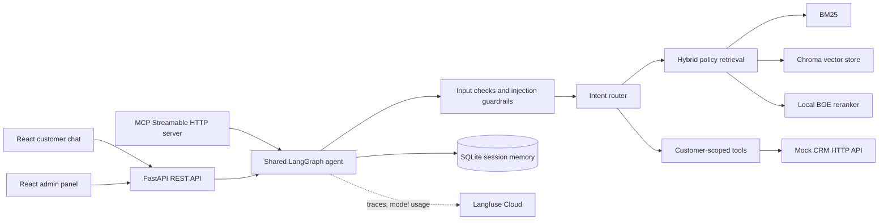

# Ticket Support Agent

A demo customer support agent for bus, movie, and event tickets. It answers policy questions
from a local knowledge base, checks and changes bookings through a mock CRM, asks for approval
before cancellation, remembers each customer session, and escalates uncertain or unhappy cases.
It provides a REST API, an MCP server, and a React + Vite customer chat and admin interface.

## Architecture



The REST and MCP interfaces are adapters. Customer identity is injected by the backend into
CRM tools; the language model does not provide a customer ID. Cancellation requires a one-time,
customer-bound approval through `POST /approve`. Admin endpoints require `X-Admin-Key`.

## Requirements

- Python 3.11 or newer
- Node.js 20 or newer and npm
- Git
- Internet access for package installation, the configured chat model, and first-time local
  embedding/reranker downloads
- GNU Make to use the `make` commands. On Windows, use Git Bash or WSL, or use the direct
  PowerShell commands below.

## Setup (PowerShell)

From a fresh clone, setup takes a few minutes before the local AI models download on first API
startup.

```powershell
git clone https://github.com/purva1651/Customer-support-agent.git
Set-Location Customer-support-agent
py -3.11 -m venv .venv
.\.venv\Scripts\Activate.ps1
python -m pip install --upgrade pip
python -m pip install -e ".[dev]"
Set-Location frontend
npm install
Set-Location ..
Copy-Item .env.example .env
```

Edit `.env`. To use Groq, set:

```dotenv
LLM_PROVIDER=groq
LLM_MODEL=<model-id>
GROQ_API_KEY=<your-groq-api-key>
GROQ_BASE_URL=https://api.groq.com/openai/v1
ADMIN_API_KEY=<choose-a-demo-admin-key>
MCP_API_KEY=<choose-a-demo-mcp-key>
```

Do not commit `.env`. Create a Groq key in the [Groq console](https://console.groq.com/keys).
To list the model IDs currently available to that key, run this in PowerShell after setting
`$env:GROQ_API_KEY`:

```powershell
Invoke-RestMethod https://api.groq.com/openai/v1/models `
  -Headers @{ Authorization = "Bearer $env:GROQ_API_KEY" }
```

Set `LLM_MODEL` to an active model ID from the response. The app uses its existing OpenAI-compatible
LangChain client with Groq's documented base URL. You can also select `xai`, `openai`, `anthropic`,
or `ollama` and provide the matching key or local server. For optional tracing, set
`LANGFUSE_PUBLIC_KEY` and `LANGFUSE_SECRET_KEY`; `LANGFUSE_HOST` defaults to Langfuse Cloud. Tracing
stays off when either key is missing or `observability.langfuse_enabled` is false.

### Optional invoice and warranty-card extraction

The API can forward customer documents to a separate Document Intelligence MCP server. That
service is not included in this repository. Ask its owner for the Streamable HTTP MCP URL and any
API key, then set these values in `.env`:

```dotenv
DOCUMENT_INTELLIGENCE_ENABLED=true
DOCUMENT_INTELLIGENCE_MCP_URL=https://<document-agent-host>/mcp
DOCUMENT_INTELLIGENCE_API_KEY=<optional-service-key>
```

The integration calls the `extract_fields` MCP tool with a base64 file, filename, and optional
document type. Argument names, tool name, authentication header, and timeout can be adjusted under
`integrations.document_intelligence` in `config/agent.yaml`. Restart the API after changing these
settings. The customer upload endpoint accepts PDF, DOCX, JPG, JPEG, and PNG files up to the
configured admin upload limit (10 MB by default). It returns 503 until the external MCP service is
configured and enabled.

For a local endpoint check, run this in PowerShell with a sample invoice file in the current
directory:

```powershell
curl.exe -X POST http://localhost:8000/documents/extract `
  -F "customer_id=C001" -F "document_type=invoice" `
  -F "file=@invoice.pdf;type=application/pdf"
```

### Optional Hindi and Gujarati translation

IndicTrans2 response translation is opt-in. The official IndicTransToolkit currently documents
Linux/macOS rather than native Windows support, so use WSL2 or Linux for this option. In that
environment, install the optional dependencies and enable translation in `config/agent.yaml`:

```bash
python -m pip install -e ".[dev,translation]"
```

```yaml
translation:
  enabled: true
  model: ai4bharat/indictrans2-en-indic-dist-200M
  device: auto
```

If Hugging Face requires model access approval, accept the model terms and set `HF_TOKEN` in
`.env`. The translation model downloads on the first Hindi or Gujarati response and runs locally;
`device: auto` uses CUDA when available and CPU otherwise. English responses continue through the
configured chat model without translation. See the [IndicTrans2 project](https://github.com/AI4Bharat/IndicTrans2)
and the [IndicTransToolkit setup notes](https://github.com/VarunGumma/IndicTransToolkit#configuration).

## Start the services

Start each service in its own terminal from the repository root, with the virtual environment
active. The API downloads and loads the local embedding and reranker models the first time it
starts; this can take several minutes and needs disk space.

The React app opens with a role selection screen. Demo customers choose `C001` or `C002` and enter
the chat; customer passwords are not configured in this demo. Admins enter `ADMIN_API_KEY`, which
the API validates before opening the admin workspace. Add a real customer authentication provider
before using customer sign-in with non-demo accounts.

| Terminal | Make command | PowerShell alternative | Address |
| --- | --- | --- | --- |
| Mock CRM | `make crm` | `python -m uvicorn mock_crm.main:app --reload --port 9000` | `http://localhost:9000` |
| Agent REST API | `make api` | `python -m uvicorn app.api.main:app --reload --port 8000` | `http://localhost:8000` |
| Customer chat + admin panel | `make frontend` | `Set-Location frontend; npm run dev` | `http://localhost:5173` |
| MCP server (optional) | `make mcp` | `python -m app.mcp_server.server` | `http://localhost:8001/mcp` |

The chat starts with demo customer `C001`; change the customer ID and response language in chat
settings. The seeded CRM also has customer `C002`; the seeded bookings are `B001`, `B002`, and
`B003`. In the admin panel, enter the same `ADMIN_API_KEY` configured for the API.

## Try the REST API

Interactive OpenAPI documentation is at `http://localhost:8000/docs`. A chat request from
PowerShell:

```powershell
$body = @{
  customer_id = "C001"
  session_id = "demo-session-1"
  message = "What is the cancellation fee?"
  language = "English"
} | ConvertTo-Json

$answer = Invoke-RestMethod http://localhost:8000/chat `
  -Method Post -ContentType "application/json" -Body $body
$answer
```

Responses contain the reply, intent, source links, tool calls, approval state, and escalation
details. If `pending_action` is present, send its `action_id` to the approval endpoint:

```powershell
$approval = @{ action_id = $answer.pending_action.action_id; approved = $true } | ConvertTo-Json
Invoke-RestMethod http://localhost:8000/approve `
  -Method Post -ContentType "application/json" -Body $approval
```

Set `approved = $false` to decline. Approval tokens expire after 10 minutes and cannot be reused.

An admin request example:

```powershell
Invoke-RestMethod http://localhost:8000/admin/knowledge `
  -Headers @{ "X-Admin-Key" = "<your-admin-key>" }
```

## MCP tools

The Streamable HTTP MCP endpoint is `http://localhost:8001/mcp`. It exposes exactly:

- `answer_question(message, language?)`
- `create_ticket(subject, details)`
- `get_order_status(booking_id)`

Send `X-API-Key`, `X-Customer-ID`, and `X-Session-ID` headers with MCP requests. Customer and
session identity are never tool arguments. The key is the `MCP_API_KEY` value in `.env`.

## Checks and evaluations

```powershell
make lint
make test
```

These run Ruff and the CI-safe test suite, excluding live-model evaluations. The test command
also reports `app/` coverage and fails below 70%. Retrieval source checks use the local policy
files and do not need an API key.

To evaluate the full hybrid retrieval stack against the 30 policy questions, run
`make eval-retrieval`. This loads the configured embedding and reranker models locally and may
download them on first use. The evaluation checks whether each expected policy source appears in
the hybrid top five; it does not require a live chat model or API key.

For live router and action-tool evaluations, configure `LLM_PROVIDER`, `LLM_MODEL`, and the
provider key, then run:

```powershell
make eval
make eval-retrieval
```

`make eval` sends the 25 prompts in `tests/evals/cases.yaml` to the configured model. Results can
vary by model and provider settings; it is separate from `make test` and may incur provider charges.
`make eval-retrieval` checks the 30 policy questions against the production hybrid retriever.
Retrieval model downloads may be needed on first use.

The sentiment escalation threshold is configurable as `agent.sentiment_escalation_threshold`
in `config/agent.yaml`. The router escalates clearly negative sentiment only when its confidence
meets that threshold; messages classified as complaints still go to human support immediately.
Admin analytics include daily chat volume and intent counts alongside resolution, escalation,
top-question, and unresolved-query data.

## Main endpoints

| Method | Path | Purpose |
| --- | --- | --- |
| `GET` | `/health` | Agent API health |
| `POST` | `/chat` | Ask a question or request an action; send `close` to close this chat's open human handoff |
| `POST` | `/approve` | Approve or decline a pending action |
| `GET` | `/admin/knowledge` | List indexed sources (admin key required) |
| `POST` | `/admin/knowledge/upload` | Upload a `.md`, `.pdf`, `.docx`, or `.txt` policy |
| `POST` | `/admin/knowledge/url` | Load a public HTTP(S) policy URL |
| `POST` | `/admin/knowledge/reindex` | Rebuild the policy index |
| `DELETE` | `/admin/knowledge?title=...` | Remove a policy source |
| `GET` | `/admin/analytics` | Chat, resolution, and top-question metrics |
| `GET` | `/admin/escalations` | Human handoff summaries and status (pending, accepted, rejected, or closed) |
| `POST` | `/admin/escalations/{id}/decision` | Accept or reject a pending human handoff |
| `GET` | `/admin/escalations/{id}/messages` | View a saved conversation after accepting the case |
| `POST` | `/admin/escalations/{id}/messages` | Reply to a customer in an accepted case |
| `GET` | `/chat/messages?customer_id=...&session_id=...` | Read the customer's conversation and agent replies |

All `/admin/*` routes require `X-Admin-Key`. The MCP endpoint uses its separate MCP API key and
identity headers described above.

Escalated customer and assistant messages are saved to the local conversation store. Accepting a
case opens its saved thread in the admin panel; agent replies appear in the customer's open chat.
Pending cases remain in the escalation list until accepted or rejected, and closed threads remain
available to admins for review.

## Known limits and troubleshooting

- This is a demo service, not a production login system. Customer IDs are demo values; protect
  the network endpoints if deploying it beyond a local machine.
- The CRM is seeded SQLite data. It does not connect to a ticket vendor, payment system, or live
  booking provider.
- The mock CRM supports booking lookup, cancellation with its configured fee and refund amount,
  support-ticket creation, and email/phone contact updates. It has no separate refund-request
  action or address update; `update_contact` is a documented deviation from the checklist wording.
- Answers are limited to retrieved policy content. If retrieval is weak or a policy is missing,
  the agent says it is unsure and escalates instead of inventing a refund rule.
- The BGE embedding and reranker models run locally. First startup requires a model download;
  restricted networks may need those model files cached before the API can start.
- LLM-dependent `make eval` needs a working provider key and model ID. If a run fails before
  reaching the model, check `LLM_PROVIDER`, `LLM_MODEL`, and the matching API key.
- Langfuse is optional. Missing keys disable tracing. Token usage is recorded by the callback;
  cost display depends on Langfuse having pricing for the selected model.
- Admin knowledge removal uses a title. If two sources share a title, the API reports an
  ambiguity instead of deleting an arbitrary source.
- Local state is stored under `data/` and is ignored by Git. Remove the local data directory to
  reset demo state and rebuild the vector index.
