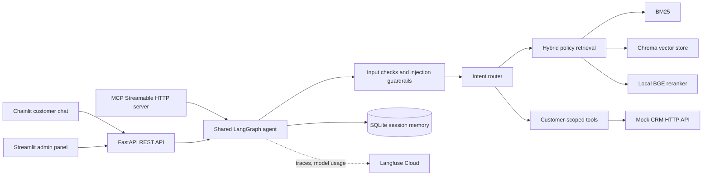

# Ticket Support Agent

A demo customer support agent for bus, movie, and event tickets. It answers policy questions
from a local knowledge base, checks and changes bookings through a mock CRM, asks for approval
before cancellation, remembers each customer session, and escalates uncertain or unhappy cases.
It provides a REST API, an MCP server, a Chainlit customer chat, and a Streamlit admin panel.

## Architecture



The REST and MCP interfaces are adapters. Customer identity is injected by the backend into
CRM tools; the language model does not provide a customer ID. Cancellation requires a one-time,
customer-bound approval through `POST /approve`. Admin endpoints require `X-Admin-Key`.

## Requirements

- Python 3.11 or newer
- Git
- Internet access for package installation, the configured chat model, and first-time local
  embedding/reranker downloads
- GNU Make to use the `make` commands. On Windows, use Git Bash or WSL, or use the direct
  PowerShell commands below.

## Setup (PowerShell)

From a fresh clone, setup takes a few minutes before the local AI models download on first API
startup.

```powershell
git clone https://github.com/purva1651/Customer-support-agent.git
Set-Location Customer-support-agent
py -3.11 -m venv .venv
.\.venv\Scripts\Activate.ps1
python -m pip install --upgrade pip
python -m pip install -e ".[dev]"
Copy-Item .env.example .env
```

Edit `.env` and set at least:

```dotenv
LLM_PROVIDER=xai
LLM_MODEL=<model-id>
XAI_API_KEY=<your-xai-api-key>
ADMIN_API_KEY=<choose-a-demo-admin-key>
MCP_API_KEY=<choose-a-demo-mcp-key>
```

Do not commit `.env`. To see the model IDs available to your xAI account, run this in
PowerShell after setting `$env:XAI_API_KEY`:

```powershell
Invoke-RestMethod https://api.x.ai/v1/models -Headers @{ Authorization = "Bearer $env:XAI_API_KEY" }
```

Set `LLM_MODEL` to one of the returned IDs. `ANTHROPIC_API_KEY`, `OPENAI_API_KEY`, and
`OLLAMA_BASE_URL` are used when you select their matching `LLM_PROVIDER`. For optional tracing,
set `LANGFUSE_PUBLIC_KEY` and `LANGFUSE_SECRET_KEY`; `LANGFUSE_HOST` defaults to Langfuse Cloud.
Tracing stays off when either key is missing or `observability.langfuse_enabled` is false.

## Start the services

Start each service in its own terminal from the repository root, with the virtual environment
active. The API downloads and loads the local embedding and reranker models the first time it
starts; this can take several minutes and needs disk space.

| Terminal | Make command | PowerShell alternative | Address |
| --- | --- | --- | --- |
| Mock CRM | `make crm` | `python -m uvicorn mock_crm.main:app --reload --port 9000` | `http://localhost:9000` |
| Agent REST API | `make api` | `python -m uvicorn app.api.main:app --reload --port 8000` | `http://localhost:8000` |
| Customer chat | `make chat` | `python -m chainlit run frontend/chat_app.py --host 0.0.0.0 --port 8002` | `http://localhost:8002` |
| Admin panel | `make admin` | `python -m streamlit run frontend/admin_app.py --server.port 8501` | `http://localhost:8501` |
| MCP server (optional) | `make mcp` | `python -m app.mcp_server.server` | `http://localhost:8001/mcp` |

The chat starts with demo customer `C001`; change the customer ID and response language in chat
settings. The seeded CRM also has customer `C002`; the seeded bookings are `B001`, `B002`, and
`B003`. In the admin panel, enter the same `ADMIN_API_KEY` configured for the API.

## Try the REST API

Interactive OpenAPI documentation is at `http://localhost:8000/docs`. A chat request from
PowerShell:

```powershell
$body = @{
  customer_id = "C001"
  session_id = "demo-session-1"
  message = "What is the cancellation fee?"
  language = "English"
} | ConvertTo-Json

$answer = Invoke-RestMethod http://localhost:8000/chat `
  -Method Post -ContentType "application/json" -Body $body
$answer
```

Responses contain the reply, intent, source links, tool calls, approval state, and escalation
details. If `pending_action` is present, send its `action_id` to the approval endpoint:

```powershell
$approval = @{ action_id = $answer.pending_action.action_id; approved = $true } | ConvertTo-Json
Invoke-RestMethod http://localhost:8000/approve `
  -Method Post -ContentType "application/json" -Body $approval
```

Set `approved = $false` to decline. Approval tokens expire after 10 minutes and cannot be reused.

An admin request example:

```powershell
Invoke-RestMethod http://localhost:8000/admin/knowledge `
  -Headers @{ "X-Admin-Key" = "<your-admin-key>" }
```

## MCP tools

The Streamable HTTP MCP endpoint is `http://localhost:8001/mcp`. It exposes exactly:

- `answer_question(message, language?)`
- `create_ticket(subject, details)`
- `get_order_status(booking_id)`

Send `X-API-Key`, `X-Customer-ID`, and `X-Session-ID` headers with MCP requests. Customer and
session identity are never tool arguments. The key is the `MCP_API_KEY` value in `.env`.

## Checks and evaluations

```powershell
make lint
make test
```

These run Ruff and the CI-safe test suite, excluding live-model evaluations. The test command
also reports `app/` coverage and fails below 70%. Retrieval source checks use the local policy
files and do not need an API key.

For live router and action-tool evaluations, configure `LLM_PROVIDER`, `LLM_MODEL`, and the
provider key, then run:

```powershell
make eval
```

This sends the 25 prompts in `tests/evals/cases.yaml` to the configured model. Results can vary
by model and provider settings; it is separate from `make test` and may incur provider charges.

## Main endpoints

| Method | Path | Purpose |
| --- | --- | --- |
| `GET` | `/health` | Agent API health |
| `POST` | `/chat` | Ask a question or request an action |
| `POST` | `/approve` | Approve or decline a pending action |
| `GET` | `/admin/knowledge` | List indexed sources (admin key required) |
| `POST` | `/admin/knowledge/upload` | Upload a `.md`, `.pdf`, `.docx`, or `.txt` policy |
| `POST` | `/admin/knowledge/url` | Load a public HTTP(S) policy URL |
| `POST` | `/admin/knowledge/reindex` | Rebuild the policy index |
| `DELETE` | `/admin/knowledge?title=...` | Remove a policy source |
| `GET` | `/admin/analytics` | Chat, resolution, and top-question metrics |
| `GET` | `/admin/escalations` | Human handoff summaries |

All `/admin/*` routes require `X-Admin-Key`. The MCP endpoint uses its separate MCP API key and
identity headers described above.

## Known limits and troubleshooting

- This is a demo service, not a production login system. Customer IDs are demo values; protect
  the network endpoints if deploying it beyond a local machine.
- The CRM is seeded SQLite data. It does not connect to a ticket vendor, payment system, or live
  booking provider.
- Answers are limited to retrieved policy content. If retrieval is weak or a policy is missing,
  the agent says it is unsure and escalates instead of inventing a refund rule.
- The BGE embedding and reranker models run locally. First startup requires a model download;
  restricted networks may need those model files cached before the API can start.
- LLM-dependent `make eval` needs a working provider key and model ID. If a run fails before
  reaching the model, check `LLM_PROVIDER`, `LLM_MODEL`, and the matching API key.
- Langfuse is optional. Missing keys disable tracing. Token usage is recorded by the callback;
  cost display depends on Langfuse having pricing for the selected model.
- Admin knowledge removal uses a title. If two sources share a title, the API reports an
  ambiguity instead of deleting an arbitrary source.
- Local state is stored under `data/` and is ignored by Git. Remove the local data directory to
  reset demo state and rebuild the vector index.
