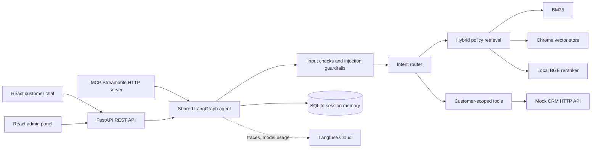

# Ticket Support Agent

A demo customer support agent for bus, movie, and event tickets. It answers policy questions
from a local knowledge base, checks and changes bookings through a mock CRM, asks for approval
before cancellation, remembers each customer session, and escalates uncertain or unhappy cases.
It provides a REST API, an MCP server, and a React + Vite customer chat and admin interface.

## What the demo supports

- Answer policy questions with citations that open local indexed documents or public source URLs.
- Look up bookings and cancel them only after customer approval.
- Save refund requests as pending CRM records. A request does not issue or approve a payment.
- Update a customer's email, phone number, or address, and create support tickets.
- Upload invoices or warranty cards and extract labeled fields through the local MCP service.
- Manage policy documents, analytics, escalations, and red-team examples from the admin panel.

Customer IDs and booking records are seeded demo data. The project is not a production booking,
payment, or authentication service.

## Architecture



The REST and MCP interfaces are adapters. Customer identity is injected by the backend into
CRM tools; the language model does not provide a customer ID. Cancellation requires a one-time,
customer-bound approval through `POST /approve`. Admin endpoints require `X-Admin-Key`.

Project design documents:

- [Product specification](docs/spec.md)
- [Low-level design](docs/LLD.md)

## Requirements

- Python 3.11 or newer
- Node.js 20 or newer and npm
- Git
- Internet access for package installation, the configured chat model, and first-time local
  embedding/reranker downloads
- GNU Make is optional. The direct PowerShell and Python commands below work on Windows.

## Setup (PowerShell)

From a fresh clone, setup takes a few minutes before the local AI models download on first API
startup.

```powershell
git clone https://github.com/purva1651/Customer-support-agent.git
Set-Location Customer-support-agent
py -3.11 -m venv .venv
.\.venv\Scripts\Activate.ps1
python -m pip install --upgrade pip
python -m pip install -e ".[dev]"
Set-Location frontend
npm install
Set-Location ..
Copy-Item .env.example .env
```

Edit `.env`. To use Groq, set:

```dotenv
LLM_PROVIDER=groq
LLM_MODEL=<model-id>
GROQ_API_KEY=<your-groq-api-key>
GROQ_BASE_URL=https://api.groq.com/openai/v1
ADMIN_API_KEY=<choose-a-demo-admin-key>
MCP_API_KEY=<choose-a-demo-mcp-key>
```

Do not commit `.env`. Create a Groq key in the [Groq console](https://console.groq.com/keys).
To list the model IDs currently available to that key, run this in PowerShell after setting
`$env:GROQ_API_KEY`:

```powershell
Invoke-RestMethod https://api.groq.com/openai/v1/models `
  -Headers @{ Authorization = "Bearer $env:GROQ_API_KEY" }
```

Set `LLM_MODEL` to an active model ID from the response. The app uses its existing OpenAI-compatible
LangChain client with Groq's documented base URL. You can also select `xai`, `openai`, `anthropic`,
or `ollama` and provide the matching key or local server. For optional tracing, set
`LANGFUSE_PUBLIC_KEY` and `LANGFUSE_SECRET_KEY`; `LANGFUSE_HOST` defaults to Langfuse Cloud. Tracing
stays off when either key is missing or `observability.langfuse_enabled` is false.

### Invoice and warranty-card extraction

The project includes an `extract_fields` MCP tool on its local MCP server. The customer upload flow
reads PDF and DOCX text locally, and uses Tesseract OCR for image uploads and scanned PDFs. It
first parses recognizable field labels locally. If it cannot find enough fields, it sends the
extracted text—not the original file—to the configured chat model for structured extraction. This
uses the existing `MCP_API_KEY` and LLM provider settings; no separate Document Intelligence server
is needed.

```dotenv
DOCUMENT_INTELLIGENCE_ENABLED=true
DOCUMENT_INTELLIGENCE_MCP_URL=http://localhost:8001/mcp
```

The API calls `extract_fields` with the uploaded file and its document type. It accepts PDF, DOCX,
JPG, JPEG, and PNG files up to the configured upload limit (10 MB by default). Start both the API
and MCP service; the MCP service is the `mcp` row in the service startup table below. Install the
updated Python dependencies with `python -m pip install -e ".[dev]"`. Install the Tesseract OCR
application on Windows and make sure `tesseract.exe` is available on `PATH` to read images and
scanned PDFs. Text extracted from the file is sent to your configured LLM provider for field
structuring; the original file is not sent to a separate document service.

To connect a different Document Intelligence MCP server, set its URL and optional API key in
`.env`. Tool name, argument names, authentication header, and timeout can be adjusted under
`integrations.document_intelligence` in `config/agent.yaml`.

For a local endpoint check, run this in PowerShell with a sample invoice file in the current
directory:

```powershell
curl.exe -X POST http://localhost:8000/documents/extract `
  -F "customer_id=C001" -F "document_type=invoice" `
  -F "file=@invoice.pdf;type=application/pdf"
```

## Start the services

Start each service in its own terminal from the repository root, with the virtual environment
active. The API downloads and loads the local embedding and reranker models the first time it
starts; this can take several minutes and needs disk space.

The React app opens with a role selection screen. Demo customers choose `C001` or `C002` and enter
the chat; customer passwords are not configured in this demo. Admins enter `ADMIN_API_KEY`, which
the API validates before opening the admin workspace. Add a real customer authentication provider
before using customer sign-in with non-demo accounts.

| Terminal | Make command | PowerShell alternative | Address |
| --- | --- | --- | --- |
| Mock CRM | `make crm` | `python -m uvicorn mock_crm.main:app --reload --port 9000` | `http://localhost:9000` |
| Agent REST API | `make api` | `python -m uvicorn app.api.main:app --reload --port 8000` | `http://localhost:8000` |
| Customer chat + admin panel | `make frontend` | `Set-Location frontend; npm run dev` | `http://localhost:5173` |
| MCP server (optional) | `make mcp` | `python -m app.mcp_server.server` | `http://localhost:8001/mcp` |

The chat starts with demo customer `C001`; change the customer ID and response language in chat
settings. The seeded CRM also has customer `C002`; the seeded bookings are `B001`, `B002`, and
`B003`. In the admin panel, enter the same `ADMIN_API_KEY` configured for the API.

## Try the REST API

Interactive OpenAPI documentation is at `http://localhost:8000/docs`. A chat request from
PowerShell:

```powershell
$body = @{
  customer_id = "C001"
  session_id = "demo-session-1"
  message = "What is the cancellation fee?"
  language = "English"
} | ConvertTo-Json

$answer = Invoke-RestMethod http://localhost:8000/chat `
  -Method Post -ContentType "application/json" -Body $body
$answer
```

Responses contain the reply, intent, source links, tool calls, approval state, and escalation
details. If `pending_action` is present, send its `action_id` to the approval endpoint:

```powershell
$approval = @{ action_id = $answer.pending_action.action_id; approved = $true } | ConvertTo-Json
Invoke-RestMethod http://localhost:8000/approve `
  -Method Post -ContentType "application/json" -Body $approval
```

Set `approved = $false` to decline. Approval tokens expire after 10 minutes and cannot be reused.

An admin request example:

```powershell
Invoke-RestMethod http://localhost:8000/admin/knowledge `
  -Headers @{ "X-Admin-Key" = "<your-admin-key>" }
```

## MCP tools

The Streamable HTTP MCP endpoint is `http://localhost:8001/mcp`. It exposes:

- `answer_question(message, language?)`
- `create_ticket(subject, details)`
- `get_order_status(booking_id)`
- `extract_fields(file_base64, filename, document_type?)`

All tools require `X-API-Key`. The customer tools `answer_question`, `create_ticket`, and
`get_order_status` also require `X-Customer-ID` and `X-Session-ID`; identity is never passed as a
tool argument. The key is the `MCP_API_KEY` value in `.env`. Through `answer_question`, customers can
also submit a refund request or update their contact email, phone number, or address. A refund
request is saved as a pending CRM record; it does not issue or approve a payment. Refund records
are not currently shown in a dedicated admin review panel.

## Checks and evaluations

### Run checks on Windows

From the repository root with `.venv` activated:

```powershell
ruff check .
python -m pytest --basetemp=.pytest_tmp -m "not eval" --cov=app --cov-report=term --cov-fail-under=70
```

These run Ruff and the CI-safe test suite; they exclude live-model evaluations. The test command
reports coverage for `app/` and requires at least 70%. The first run may install or download local
embedding and reranker models depending on what is already cached.

To check the complete hybrid search and reranking pipeline against 30 policy questions, run:

```powershell
python -m pytest --basetemp=.pytest_tmp -m eval tests/evals/test_hybrid_retrieval.py -q
```

This evaluation uses the local embedding, vector search, and reranker models. It does not need an
LLM API key, but may download retrieval models the first time.

For the live router and action-selection evaluation, set `LLM_PROVIDER`, `LLM_MODEL`, and the
matching provider key in `.env`, then run:

```powershell
python -m pytest --basetemp=.pytest_tmp -m eval tests/evals/test_live_evals.py -q
```

It sends the 25 prompts in `tests/evals/cases.yaml` to the configured model. Results may vary by
model and provider, and the run may use paid API credits. The current cases do not yet evaluate
refund requests or address changes.

These commands print test results; they do not create a separate evaluation report file. A RAGAS
faithfulness/relevance report is not included.

GNU Make aliases are also available: `make lint`, `make test`, `make eval`, and
`make eval-retrieval`.

The sentiment escalation threshold is configurable as `agent.sentiment_escalation_threshold`
in `config/agent.yaml`. The router escalates clearly negative sentiment only when its confidence
meets that threshold; messages classified as complaints still go to human support immediately.
Admin analytics include daily chat volume and intent counts alongside resolution, escalation,
top-question, and unresolved-query data.

## Main endpoints

| Method | Path | Purpose |
| --- | --- | --- |
| `GET` | `/health` | Agent API health |
| `POST` | `/chat` | Ask a question or request an action; send `close` to close this chat's open human handoff |
| `POST` | `/approve` | Approve or decline a pending action |
| `GET` | `/knowledge/source/{source_id}` | Open an indexed local knowledge file cited by the assistant |
| `POST` | `/documents/extract` | Extract fields from an uploaded invoice or warranty card |
| `GET` | `/admin/knowledge` | List indexed sources (admin key required) |
| `POST` | `/admin/knowledge/upload` | Upload a `.md`, `.pdf`, `.docx`, or `.txt` policy |
| `POST` | `/admin/knowledge/url` | Load a public HTTP(S) policy URL |
| `POST` | `/admin/knowledge/reindex` | Rebuild the policy index |
| `DELETE` | `/admin/knowledge?title=...` | Remove a policy source |
| `GET` | `/admin/analytics` | Chat, resolution, and top-question metrics |
| `GET` | `/admin/escalations` | Human handoff summaries and status (pending, accepted, rejected, or closed) |
| `POST` | `/admin/escalations/{id}/decision` | Accept or reject a pending human handoff |
| `GET` | `/admin/escalations/{id}/messages` | View a saved conversation after accepting the case |
| `POST` | `/admin/escalations/{id}/messages` | Reply to a customer in an accepted case |
| `GET` | `/chat/messages?customer_id=...&session_id=...` | Read the customer's conversation and agent replies |

All `/admin/*` routes require `X-Admin-Key`. The MCP endpoint uses its separate MCP API key and
identity headers described above.

Escalated customer and assistant messages are saved to the local conversation store. Accepting a
case opens its saved thread in the admin panel; agent replies appear in the customer's open chat.
Pending cases remain in the escalation list until accepted or rejected, and closed threads remain
available to admins for review.

## Known limits and troubleshooting

- This is a demo service, not a production login system. Customer IDs are demo values; protect
  the network endpoints if deploying it beyond a local machine.
- The CRM is seeded SQLite data. It does not connect to a ticket vendor, payment system, or live
  booking provider.
- The mock CRM supports booking lookup, cancellation with its configured fee and refund amount,
  pending refund-request records, support-ticket creation, and email, phone, or address updates.
  Refund records are not currently shown in a dedicated admin review panel, and a request does not
  issue or approve a payment.
- The project is focused on booking and ticket support. General IT/HR helpdesk workflows, WhatsApp
  or website widgets, voice input/output, and automatic FAQ generation are not implemented.
- Answers are limited to retrieved policy content. If retrieval is weak or a policy is missing,
  the agent says it is unsure and escalates instead of inventing a refund rule.
- The BGE embedding and reranker models run locally. First startup requires a model download;
  restricted networks may need those model files cached before the API can start.
- LLM-dependent `make eval` needs a working provider key and model ID. If a run fails before
  reaching the model, check `LLM_PROVIDER`, `LLM_MODEL`, and the matching API key.
- Langfuse is optional. Missing keys disable tracing. Token usage is recorded by the callback;
  cost display depends on Langfuse having pricing for the selected model.
- Admin knowledge removal uses a title. If two sources share a title, the API reports an
  ambiguity instead of deleting an arbitrary source.
- Local state is stored under `data/` and is ignored by Git. Remove the local data directory to
  reset demo state and rebuild the vector index.
