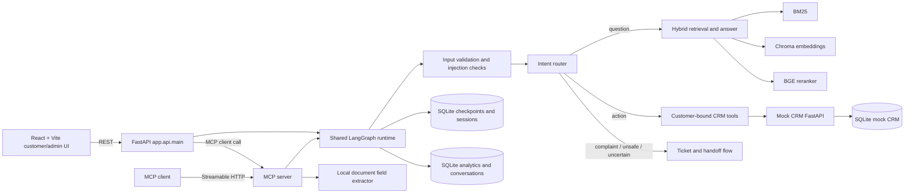

# Ticket Support Agent: Low-Level Design

## 1. Design status

This is an as-built design for the current repository. Paths and defaults refer to the implementation
in `app/`, `mock_crm/`, `frontend/`, and `config/`. Optional/deferred work is listed at the end.

## 2. Runtime topology

The React development server, REST API, mock CRM, and optional MCP server run as separate local
processes. The REST and MCP adapters use the same Python agent implementation, but are separately
started services and build their own service containers.

## 3. Code responsibilities

| Area | Main modules | Responsibility |
| --- | --- | --- |
| Web client | `frontend/src/App.tsx`, `frontend/src/api.ts` | Login/role selection for demo accounts, customer chat, document upload, admin pages, API calls, source URL resolution, and presentation of approvals/escalations. |
| REST app | `app/api/main.py`, `app/api/routes_chat.py`, `app/api/routes_admin.py` | Lifecycle, CORS, chat/approval/document endpoints, source serving, and protected admin endpoints. |
| Service assembly | `app/api/dependencies.py` | Load YAML/environment settings; create model, CRM client, indexer/retriever, runtime, stores, and document client. |
| Agent | `app/agent/graph.py`, `nodes.py`, `router.py`, `runtime.py` | Guardrails, intent routing, question/action/complaint/small-talk flow, approvals, persistence, timeout handoff, and response construction. |
| Retrieval | `app/ingestion/`, `app/retrieval/` | Load and chunk policy files, maintain the index, combine keyword/vector search, and rerank candidates. |
| CRM tools | `app/tools/` | Create customer-bound wrappers for booking, cancellation, ticket, contact, and refund-request operations. |
| Mock CRM | `mock_crm/main.py`, `db.py`, `schemas.py`, `seed.py` | Validate CRM requests and read/write seeded local SQLite data. |
| MCP adapter | `app/mcp_server/server.py` | Authenticated Streamable HTTP wrappers for the agent, CRM actions, and local document extractor. |
| Document extraction | `app/document_intelligence/extractor.py`, `app/integrations/document_intelligence.py` | Read uploads locally, parse/OCR text, invoke `extract_fields` over MCP, and normalize MCP results for REST. |
| Config and prompts | `config/agent.yaml`, `tools.yaml`, `intents.yaml`, `prompts.yaml` | Runtime settings, enabled tools, intent descriptions, and LLM instruction templates. |

## 4. Request and workflow design

### 4.1 Chat request

1. `POST /chat` validates `ChatRequest`: customer ID, session ID, a non-empty message up to 2,000
   characters, and one of English/Hindi/Gujarati.
2. `AgentRuntime.chat` binds the session to its first customer in `SessionOwnerStore`. Reuse by a
   different customer is rejected.
3. The compiled LangGraph runs guardrails, router, one work node, and response/handoff handling.
4. The runtime constructs `ChatResponse`, applies configured translation if enabled, and adds the
   close instruction to escalated replies.
5. The REST route records analytics and conversation messages. The frontend keeps its own chat
   session ID and cached messages, then polls saved human-agent replies for an accepted handoff.

### 4.2 Agent graph

- **Guardrails:** normalize/validate the customer message and check configured injection patterns.
- **Router:** uses structured LLM output to choose `question`, `action`, `complaint`, or
  `small_talk`, and to assess negative sentiment. A clear refund request naming a `B<n>` booking is
  routed directly to the safe request-recording action.
- **Question:** run `HybridSearch`. If the best reranker score is below `retrieval.min_score`,
  escalate. Otherwise pass selected source titles, URLs, and policy text to the answer model and
  return citations.
- **Action:** use enabled tools from `config/tools.yaml`. Customer IDs are bound in Python tool
  constructors, not accepted from the model. Explicit refund requests are deterministically mapped
  to `request_refund`; other actions use structured tool selection.
- **Cancellation approval:** store a one-time cancellation action in `approvals.sqlite3`, return a
  pending action to the UI, and do not call the CRM until `POST /approve` accepts it. Decline,
  expiry, and reuse are handled as separate outcomes.
- **Other actions:** request refund, booking lookup, ticket creation, and contact updates invoke the
  mock CRM through `httpx`. A refund request only creates a pending record. Cancellation remains
  the only configured action requiring customer approval.
- **Complaint/escalation:** build a short summary, attempt ticket creation, record a pending
  escalation, and save customer/assistant messages. Admin acceptance enables saved-thread viewing
  and replying; rejection and close update escalation state.
- **Timeout:** if the graph exceeds `agent.request_timeout_seconds`, the runtime attempts a human
  handoff and ticket creation.

### 4.3 Retrieval and citations

1. `KnowledgeIndexer` reads `.md`, `.txt`, `.pdf`, and `.docx` files in the configured knowledge
   directory. The admin can also add text or load a public web URL.
2. `KnowledgeChunker` uses the configured token chunk size and overlap and assigns stable chunk IDs.
3. `HybridSearch` takes candidates from BM25 and Chroma vector similarity, combines ranks with
   reciprocal-rank fusion, reranks candidates with the local BGE reranker, and returns the
   configured result count (three by default).
4. Each local citation uses an opaque SHA-256 identifier derived from the resolved local source
   path. `GET /knowledge/source/{source_id}` serves only a currently indexed file under the
   knowledge root. URL citations link to their public source.

Default retrieval settings are in `config/agent.yaml`: BGE-M3 embeddings, BGE reranker,
chunk size 400, overlap 60, eight candidates, three answer sources, and minimum reranker score
0.25. The 30-question retrieval evaluation checks expected sources in the hybrid top five.

### 4.4 Document extraction

1. The React client sends a multipart request to `POST /documents/extract` with customer ID, file,
   and optional document type.
2. The REST route checks the customer ID, file extension, non-empty content, and configured maximum
   size (10 MiB by default).
3. `DocumentIntelligenceClient` sends base64 content, filename, and optional document type to the
   configured MCP tool (`extract_fields`). For the default local setup, it authenticates with
   `MCP_API_KEY`.
4. The MCP server verifies the API key and size, decodes the upload, and calls the extractor in a
   worker thread.
5. The extractor reads digital PDF/DOCX text directly and uses Tesseract for images or scanned
   PDFs. It returns labeled fields directly when it finds enough; otherwise it asks the configured
   LLM to structure the extracted text. The original uploaded file is not sent to that LLM.
6. The API unwraps the MCP result into `{filename, document_type, fields, source}` for the UI.

Supported files: PDF, DOCX, JPG, JPEG, PNG. `pytesseract` is a Python wrapper; Windows also needs
the Tesseract application installed and available on `PATH` for OCR.

## 5. HTTP and MCP interfaces

### 5.1 Agent REST API

| Method and path | Purpose | Access |
| --- | --- | --- |
| `GET /health` | Liveness response. | Public |
| `POST /chat` | Run a customer chat/action request. | Demo customer/session values in body |
| `POST /approve` | Approve or decline a pending cancellation. | Single-use action token in body |
| `GET /chat/messages` | Read a customer's saved escalation conversation. | Customer and session query values |
| `GET /knowledge/source/{source_id}` | Serve a cited indexed local file. | Public, but restricted to indexed files within the knowledge root |
| `POST /documents/extract` | Extract fields from an uploaded invoice/warranty card. | Customer ID in multipart body; MCP API key is used server-to-server |
| `/admin/knowledge/*` | List/add/reindex/remove knowledge sources. | `X-Admin-Key` |
| `/admin/analytics` | Return chat, resolution, intent, and query statistics. | `X-Admin-Key` |
| `/admin/escalations/*` | List, decide, read, and reply to human handoffs. | `X-Admin-Key` |

Schemas are defined in `app/schemas.py`. Admin knowledge upload supports Markdown, text, PDF, and
DOCX. Public URL ingestion rejects local/private destinations.

### 5.2 Mock CRM API

| Method and path | Purpose |
| --- | --- |
| `GET /health` | CRM health response. |
| `GET /bookings/{booking_id}?customer_id=...` | Customer-scoped booking lookup. |
| `POST /bookings/{booking_id}/cancel?customer_id=...` | Cancel a booking, apply the mock CRM's 10% fee, and return the remaining amount. Invoked only after approval by the agent. |
| `POST /bookings/{booking_id}/refund-requests?customer_id=...` | Store/reuse a pending refund request for an owned booking; does not pay. |
| `POST /tickets` | Create a support ticket. |
| `PATCH /customers/{customer_id}/contact` | Update email, phone, and/or address. |

Booking ownership is checked in database queries. Unknown and other-customer bookings both return
not found. Customer identity in this local demo is not authenticated independently of the API
request.

### 5.3 MCP tools

`app/mcp_server/server.py` exposes:

- `answer_question(message, language?)`
- `create_ticket(subject, details)`
- `get_order_status(booking_id)`
- `extract_fields(file_base64, filename, document_type?)`

All calls require `X-API-Key`. The first three require customer and session headers too; those
identity values are not tool arguments. `extract_fields` requires only the API key. The answer tool
uses the shared agent graph, so the graph's action and approval rules apply.

## 6. Persistence and data model

| Store | Default path | Data |
| --- | --- | --- |
| LangGraph checkpoints and session-owner table | `data/checkpoints.sqlite` | Agent conversation state and customer/session bindings. |
| Approval actions | `data/approvals.sqlite3` | Opaque action token, customer, booking, approved tool arguments, expiry, and consumption time. |
| Analytics/escalations/conversations | `data/analytics.sqlite3` | Chat events, resolution state, escalation state, ticket link, and customer/assistant/admin messages. |
| Mock CRM | `data/mock_crm.sqlite3` | Seeded customers/bookings, tickets, and pending refund-request records. Customer address column is added by startup migration where needed. |
| Chroma collection | `data/chroma/` | Persisted document embeddings. |
| Index manifest | `data/index_manifest.json` | Indexed file hashes and chunk IDs used to sync changes/removals. |

Runtime data directories are local and ignored by Git. The project does not provide a backup,
retention, or production database migration service.

## 7. Configuration and important limits

- `config/agent.yaml`: providers, model, timeouts, directories, retrieval settings, and service
  ports.
- `config/tools.yaml`: enablement, approval requirement, timeout, and retry count per tool.
- `config/intents.yaml` and `config/prompts.yaml`: router intent descriptions and LLM prompts.
- `.env`: API keys, provider URLs, admin/MCP keys, CRM/API URLs, and optional Langfuse/HF settings.
  Never commit this file.
- Customer sign-in is demo-only; admin security is an API key, not a user account system.
- There is no real payment/refund-processing integration. Refund requests are not currently shown
  in an admin review screen.
- Translation is disabled by default; IndicTrans2 is optional and not verified as enabled here.
- No RAGAS report, WhatsApp/widget, voice, automatic FAQ generation, or generalized IT/HR workflow
  is implemented.

## 8. Evaluation implementation

- CI-safe tests are run by `make test` and exclude tests marked `eval`.
- `make eval-retrieval` runs `tests/evals/test_hybrid_retrieval.py`: 30 questions against hybrid
  retrieval plus reranking.
- `make eval` runs `tests/evals/test_live_evals.py`: 25 live model router/action-selection cases.
  Current live cases do not cover refund requests or address changes and may use paid API credits.
- Evaluation commands report through pytest output only. There is no generated report artifact or
  RAGAS faithfulness/relevance evaluation.
